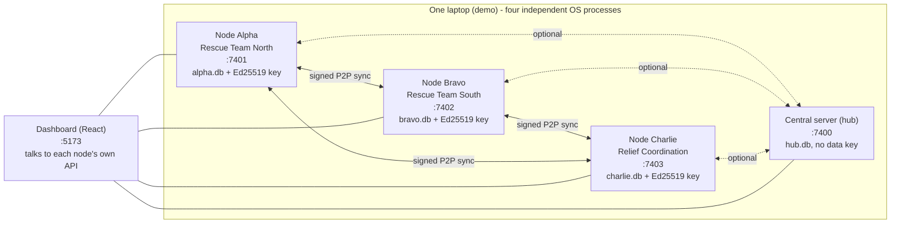
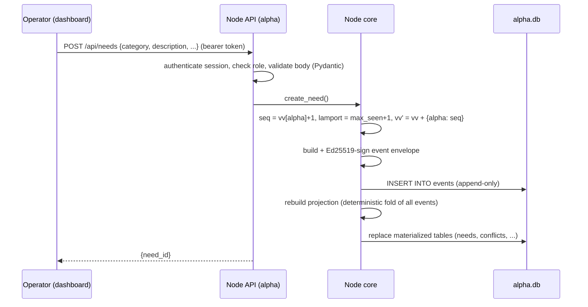
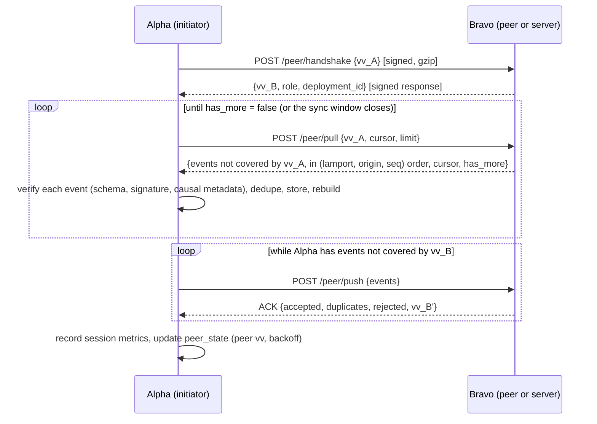

# RelayAid Architecture

RelayAid is an offline-first coordination system. Every field device is a **node**: an independent replica with its own database, identity and clocks, which keeps working with no network at all. Nodes exchange **signed events** directly with each other whenever a link exists, and with an **optional central server** when it is reachable.

## 1. System overview

| Component | Code | Responsibility |
|---|---|---|
| Node service | `backend/relayaid/api.py`, `serve.py` | One FastAPI process per node: operator API (`/api/*`) and peer protocol (`/peer/*`) |
| Node core | `backend/relayaid/node.py` | Local operations, event creation, idempotent ingestion, queries |
| Event model | `backend/relayaid/events.py` | Envelope, signatures, strict payload schemas per event type |
| Projection | `backend/relayaid/projection.py` | Deterministic fold of the event set into state; merge policies; conflict detection; allocation validation |
| Storage | `backend/relayaid/db.py` | One SQLite file per node: event log, local state, materialized tables |
| Sync engine | `backend/relayaid/sync.py` | Handshake / pull / push protocol, batching, retries, backoff, metrics, background gossip |
| Security | `backend/relayaid/security.py`, `crypto.py` | Operator sessions, peer request signing, replay protection, AES-GCM, scrypt |
| Network simulator | `backend/relayaid/netsim.py` | Per-node offline/partition/latency/loss/window/duplicate/shuffle settings |
| Provisioning | `backend/relayaid/config.py`, `scripts/bootstrap.py` | Deployment roster, node identities, wrapped data keys, operator accounts |
| Dashboard | `frontend/src` | Operations UI, partition lab, analytics |

## 2. Nodes are genuinely independent

- Each node runs as its **own OS process** (`python -m relayaid.serve --node alpha`) on its own port.
- Each node opens **only its own SQLite file** (`runtime-data/alpha/alpha.db`). There is no shared database, and no node reads another node's file.
- Each node has its **own Ed25519 private key** (`runtime-data/alpha/identity.key`), Lamport clock, version vector, sync state and simulated network state.
- All writes are local. `Node.append_local()` validates, signs and stores an event without any network call. The central server is never on the write path.

## 3. Data flow for a local write

## 4. Data flow for synchronization

The same protocol is used node-to-node and node-to-server. The server is just another replica that happens to be well connected and holds no data key.

## 5. Event processing pipeline

1. **Receive**: a batch arrives in a signed, gzip-compressed message.
2. **Authenticate the channel**: the request signature, timestamp window and nonce are checked against the roster (`security.verify_peer_request`).
3. **Deduplicate**: an `event_id` that is already stored is counted as a duplicate and skipped.
4. **Validate**: envelope shape, origin is a roster member, `vv[origin] == seq`, `lamport >= seq`, schema version, payload size, payload schema for the event type, canonical form, and the origin's Ed25519 signature (`events.verify_event`).
5. **Reject equivocation**: a different event claiming an already-used `(origin, seq)` is rejected.
6. **Store**: accepted events are inserted in one transaction.
7. **Recompute**: the version vector (highest contiguous seq per origin) and the projection are rebuilt.
8. **Acknowledge**: the receiver returns accepted ids, duplicates, rejections and its new version vector.

## 6. Projection (state) layer

State is never synchronized directly. `projection.Projection` sorts the full event set by `(lamport, origin, seq)` and folds it through per-field merge rules:

| Data | Policy | Behaviour on concurrent updates |
|---|---|---|
| Need description, quantity, unit, location, responsible team; shelter name, location, accessibility, conditions; task title/description/location; team fields; supply metadata | LWW register | Deterministic winner by (Lamport, node id); recorded as an `auto_merged` conflict |
| Need and task priority | Max lattice | Highest priority wins |
| Task status | Lattice open < assigned < in_progress < completed/cancelled | Most advanced status wins; completed vs cancelled is an open conflict |
| Need status, shelter capacity and status, task assignment, person status | Critical multi-value register | All candidates kept, field marked disputed, conflict stays `open` until resolved |
| Shelter occupancy | PN-counter of deltas | All arrivals and departures count; over-capacity becomes an `invariant` conflict |
| Notes, person evidence | Grow-only set | Union, nothing lost |
| Supply quantities | Escrow rights validated causally | Spending rights a node did not causally hold is rejected |
| Indivisible resources | Exclusive token with epochs | Only the current holder at the current epoch may allocate or transfer |

See [DISTRIBUTED_SYSTEMS_DESIGN.md](DISTRIBUTED_SYSTEMS_DESIGN.md) for the reasoning behind each choice.

## 7. Peer connections

- Peers are **manually configured** through the deployment roster (`runtime-data/deployment.json`) created at provisioning ("pairing"). There is no discovery server.
- Every node runs a background **gossip loop** (default every 5 s) that syncs with each reachable peer and server, skipping peers in backoff after failures. Sync can also be triggered manually from the Sync Center or the Partition Lab.
- The partition simulator is enforced on both ends: the initiator does not send to a cut peer, and the receiver answers `503 link_down` to a peer it has cut.

## 8. Central server

The hub (`role: server`) runs the same code with three differences: it has no operator accounts, it refuses to originate field records, and it was never given the data-encryption key. It stores and relays every event, so two teams that never meet can still exchange updates through it, but it cannot read person records and is not needed for any local operation.

## 9. Conflict resolution and allocation safety (summary)

- Conflicts are **derived** from the event log, so every replica with the same events shows the same conflicts. A conflict closes only through a write that causally dominates every competing candidate - an explicit `conflict.resolved` event or a deliberate update by someone who saw all candidates. Late, concurrent writes re-open nothing silently: they join the open conflict as new candidates.
- Scarce resources are protected by **escrow rights** (divisible stock) and **exclusive tokens** (indivisible units). A node can allocate offline only what it holds. The projection re-validates every allocation, transfer, release and write-off against the origin's causal past, so even a validly signed event from a buggy or malicious node cannot create a double allocation on any replica.

## 10. Deployment views

| Mode | How | Status |
|---|---|---|
| Local processes | `python scripts/run_cluster.py --seed` + `npm run dev` | Used for development, the demo and E8 measurements |
| Docker Compose | `docker compose run --rm bootstrap` then `docker compose up --build` | Provided; not executed in the reference environment (Docker not installed) |
| In-process test cluster | `backend/tests/conftest.py` | Used by the automated tests and benchmarks E1-E7 |
