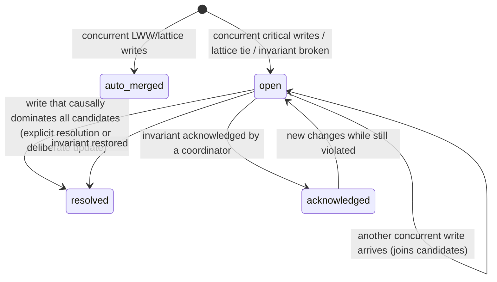

# Distributed Systems Design

This document explains the distributed-systems decisions in RelayAid, what they guarantee, and where the guarantees stop.

## 1. Offline-first

**Requirement:** a team must be able to record and update information with no connectivity to anyone.

**Design:** every operation is evaluated against the node's own replica and recorded as an event in the node's own log. No operation waits for a peer or the server. The network is used only to move events between logs.

**Consequence:** the system is **AP** in CAP terms for ordinary coordination data (needs, shelters, tasks, notes, people updates): it stays available during partitions and converges afterwards. For scarce-resource allocation it deliberately gives up some availability to keep safety (Section 9).

## 2. Event-based state

Each change is an immutable event:

```json
{
  "event_id": "ev_3f0c9a1e2b7d4c5e8a90",
  "origin": "alpha",
  "seq": 12,
  "lamport": 31,
  "vv": {"alpha": 12, "bravo": 7, "charlie": 9},
  "entity_type": "shelter",
  "entity_id": "sh_8d2...",
  "type": "shelter.occupancy_changed",
  "payload": {"delta": 6, "reason": "bus from north"},
  "created_at": "2026-11-20T06:08:31.512+00:00",
  "schema": 1,
  "sig": "Ed25519 signature of the origin over all fields above"
}
```

Why events rather than replicated rows?

- **History is preserved by construction.** Nothing is overwritten; the audit trail is the data.
- **Synchronization reduces to set union.** Replicas exchange the events the other side lacks; duplicates are recognised by `event_id`.
- **State is a pure function of the event set**, which is the basis of the convergence argument (Section 6).
- **Semantic merging becomes possible**, because the projection sees every competing intention instead of a final row.

## 3. Causality: Lamport clocks and version vectors

RelayAid uses both, for different jobs.

| Mechanism | Stored as | Used for |
|---|---|---|
| Per-origin sequence number | `seq` | Contiguity, equivocation detection, sync diffing |
| Lamport clock | `lamport` | A total order consistent with causality for the deterministic fold |
| Version vector (causal context) | `vv` in each event, node `vv` in memory | Exact happened-before tests for concurrency detection and rights validation; sync diffing |

**Lamport rule:** a new local event gets `lamport = max(all events seen) + 1`. If `a` happened before `b`, then `lamport(a) < lamport(b)`. Sorting by `(lamport, origin, seq)` is therefore a valid linear extension of causality, and identical on every replica.

**Version vector rule:** the event's `vv` is the origin's contiguous knowledge including itself. Then

> `a` happened before `b`  ⇔  `b.vv[a.origin] ≥ a.seq` (and `a ≠ b`)

Two events are **concurrent** when neither happened before the other. This exact test is what lets RelayAid tell "Bravo changed it after seeing Alpha's change" (a deliberate update) apart from "Bravo changed it while partitioned from Alpha" (a conflict).

Why not only Lamport clocks? Lamport order cannot detect concurrency; it would force a winner. Why not hybrid logical clocks or wall clocks? Device clocks in a disaster zone are unreliable; wall time is stored only for display.

Cost: one vector entry per node per event. With a handful of nodes per deployment this is tens of bytes; it would need compaction (e.g. dotted version vectors or causal stability pruning) for hundreds of nodes.

## 4. Synchronization protocol

Anti-entropy with version vectors (details in [API_DOCUMENTATION.md](API_DOCUMENTATION.md#peer-protocol)):

1. **Handshake** - exchange version vectors.
2. **Pull** - the peer streams events above the initiator's vector, in `(lamport, origin, seq)` order, paginated by a cursor in bounded batches (default 100).
3. **Push** - the initiator sends what the peer lacks, in bounded batches; each batch is acknowledged with the peer's new vector.

Properties:

- **Incremental:** a sync with nothing new moves only the handshake (measured 321-324 bytes on the wire in-process, about 370 bytes between real processes); a sync carrying one new event measured 657-667 bytes, independent of how many events already exist (benchmark E1).
- **Causally ordered streaming:** because batches follow Lamport order, any prefix of the stream is causally closed and contiguous per origin. If a short sync window closes after one batch, the receiver has a consistent prefix, and the next session resumes from its new vector (tested in `test_partial_sync_in_short_window_resumes_later`).
- **Idempotent:** receiving an event twice is a no-op. Retries, duplicate deliveries, and the same event arriving via different peers are all safe.
- **Atomic batches:** each batch is stored in one transaction; a failure loses at most the in-flight batch, which is retried.
- **Retry and backoff:** each request is retried up to 3 times with exponential delay; failed sessions push the peer's next automatic attempt back exponentially (2, 4, 8 ... 60 s).
- **Compact:** canonical JSON, gzip-compressed (measured 2.95x smaller than raw JSON for a 10-event sync and 3.9x for 100-1,000 events; about 129 wire bytes per event in bulk, benchmark E1).

## 5. Idempotency and deduplication

- `event_id` is a random 80-bit identifier, stable across replicas; `(origin, seq)` is unique.
- Ingestion skips known ids and counts them (`duplicate_events_ignored`).
- A *different* event claiming an existing `(origin, seq)` is rejected as equivocation.
- Allocation ids, transfer ids, note ids and request ids are generated once by the originating node and live inside the event, so replaying a transfer or allocation event cannot duplicate rights or allocations; the projection also rejects a second allocation event reusing an allocation id.

## 6. Convergence

**Claim.** Two replicas holding the same set of events have identical materialized state.

**Argument.** The projection (a) sorts events by `(lamport, origin, seq)`, a total order that depends only on the events, and (b) applies pure, deterministic functions - no wall clock, randomness or local state is consulted. Hence equal sets give equal outputs. Anti-entropy guarantees that, once every pair of nodes is (transitively) connected long enough, every node holds every event. So all replicas reach the same state: **strong eventual consistency** for the projection.

**Evidence.** Tests and benchmarks compare SHA-256 digests of every materialized table across nodes (not a status flag): `test_randomized_partitions_converge_without_lost_updates`, `test_projection_is_independent_of_arrival_order` (replays the log one event at a time in shuffled orders into a fresh node), `test_conflict_set_converges_too`, benchmark E2/E3/E8.

**Assumptions.** Eventual connectivity (a permanently isolated node cannot converge); all nodes run the same projection code version (`schema: 1`); nodes are not compromised (a compromised node can still write wrong-but-valid data, see SECURITY_AND_PRIVACY.md).

**Cost.** The MVP refolds all events after each write or batch. Measured median rebuild: 9.6 ms at 100 events, 110 ms at 1,000 and 312 ms at 3,000 on the reference laptop (benchmark E7) - linear growth. Incremental projection or snapshots are listed as future work.

## 7. Merge strategy: CRDT concepts per field

RelayAid is not one generic CRDT; each field gets the semantics its meaning requires.

| CRDT concept | RelayAid use | Why |
|---|---|---|
| **LWW-register** (Lamport + node-id tiebreak) | descriptive fields | Losing one of two concurrent typo fixes is acceptable; both values remain in history and the merge is recorded |
| **Max-register / lattice** | priority, task status | Monotonic meaning: if anyone escalated, keep the escalation; progress does not go backwards by accident |
| **Multi-value register** | critical fields | When the meaning of the disagreement matters (is the person found? how many fit in the shelter?), keep all values and ask a human |
| **PN-counter** | shelter occupancy | Concurrent check-ins at two doors both happened |
| **G-set** | notes, evidence | Independent observations should all survive |

Each register keeps its **frontier**: the writes not superseded by a causally later write. More than one distinct value in the frontier means concurrent disagreement. The policy decides whether the projection picks a deterministic winner (recorded as `auto_merged`) or leaves the field disputed (`open` conflict).

## 8. Conflict lifecycle



Key safety property: a conflict **cannot disappear because a device synchronized late**. A resolution only closes the conflict if its version vector covers every candidate. If an unseen concurrent write arrives later, it joins the open conflict (tested in `test_resolution_racing_a_new_concurrent_write_keeps_conflict_open`). The API also refuses plain edits of a disputed critical field (`409`) so the Conflict Center is the path to resolve it.

Person status additionally drives `verification`: `verified` only when a `person.verified` event references the current winning status event and the field is not disputed. A new status report is always shown as an unverified report.

## 9. Scarce resources: escrow rights and exclusive tokens

**Why merging is not enough.** A CRDT guarantees that replicas agree *eventually*. It cannot stop two disconnected nodes from each allocating the last boat *now*: after the merge both allocations exist, and no merge function can un-send the boat. Preventing double allocation needs a rule that each node can check locally, without communication, and that cannot be satisfied by two nodes at once.

**Quantity (escrow).** The registering node starts with rights equal to the stock. Rights move between nodes only through `supply.rights_transferred` events created by the sender. A node may allocate, transfer or write off at most

```
known_credits(node, e) - debits(node)
```

where `known_credits` counts only credits in the causal past of the spending event `e` (registration, restocks, transfers received, releases of its own allocations), checked with the version vector. Because only the node itself can debit its own balance, and its events are totally ordered by its `seq`, the sum of all allocations can never exceed the stock, under any partition.

**Indivisible (token).** Each unit has a holder and an epoch. Only the holder at the current epoch may allocate it, mark it unavailable, or transfer it; a transfer moves the token to the receiver and increments the epoch; a transfer is refused while the unit is allocated. Exactly one node holds the token in any causal history, so two concurrent allocations are impossible.

**Validation is replicated.** The local API checks first (and explains the refusal). The projection re-checks every rights-spending event on every replica, so a validly signed but invalid event (bug or misbehaving node) is rejected everywhere and recorded in `rejected_events` (tested with forged events in `test_forged_allocation_without_token_is_rejected_everywhere`, `test_forged_overspend_is_rejected_by_every_replica`, `test_rights_not_yet_received_cannot_be_spent`, benchmark E4).

**The trade-off.** A node without rights cannot allocate while partitioned, even if stock exists elsewhere. That is intentional: safety over availability for scarce resources. Mitigations: pre-distribute rights before deployment (the demo seed splits water rights across all three teams), request rights (`supply.rights_requested`) which the holder approves on next contact, and keep all other coordination fully available.

## 10. Network partition behaviour

| Situation | Behaviour |
|---|---|
| Node fully offline | All local reads and writes work; sync attempts produce no traffic and are logged as `link_down` |
| Two groups partitioned | Each group converges internally; across the cut, updates queue as "pending events" |
| Server down | Peers continue directly; the server catches up when it returns |
| Weak link (loss) | Requests retry with backoff; sessions may be `partial`; progress is kept per batch |
| Short sync windows | `window_batches` limits batches per session; consistent prefixes are kept and resumed |
| Duplicate / reordered delivery | Deduplicated and order-independent |
| Partition heals | Gossip converges; concurrent critical edits appear as open conflicts |

## 11. Trade-offs and limitations

- **Full refold per change** is simple and obviously deterministic but O(n) per write; fine for thousands of events, not for millions.
- **No log compaction**: events are kept forever; storage grows linearly.
- **Version vectors grow with the number of origins**; fine for a team-scale deployment.
- **LWW can drop a value from current state** for non-critical fields; the value remains in history and the merge is listed as `auto_merged`.
- **Occupancy counter assumes deltas**, so two concurrent "recount" corrections would double-adjust; capacity invariants surface the result rather than hide it.
- **Rights availability**: an unlucky distribution of rights can block an allocation that a central system would allow.
- **Same code version assumed** on all nodes; a schema migration strategy is future work.
- **Byzantine nodes** are only partly handled: invalid allocations and tampered or forged-origin events are rejected, but a compromised node can still sign wrong-but-valid data.
