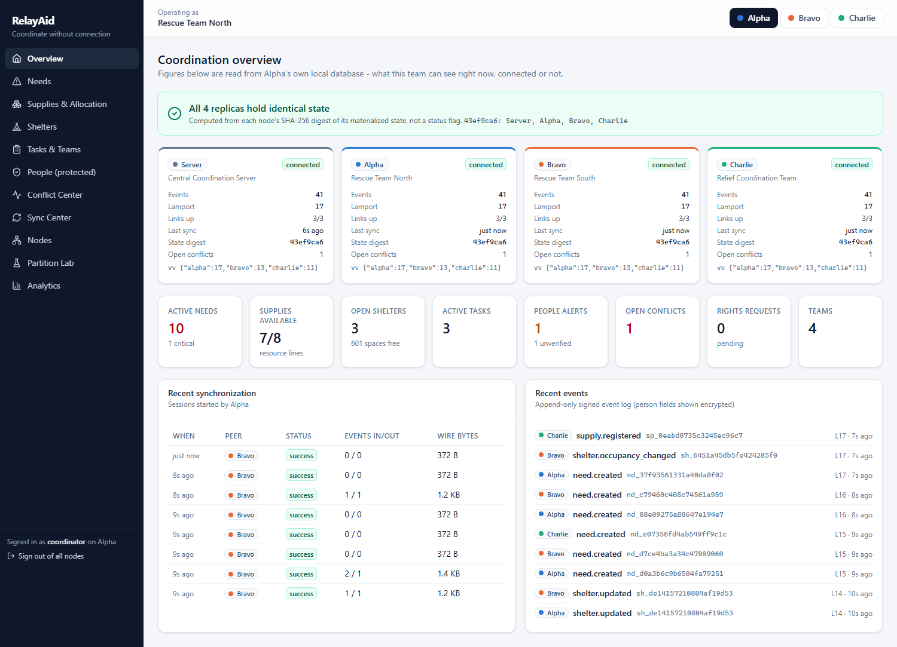
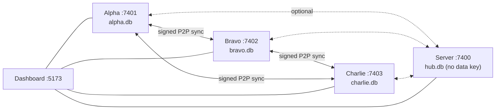
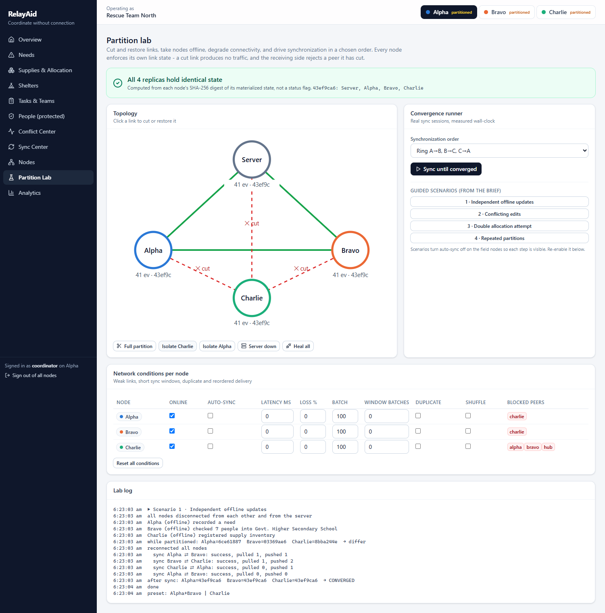
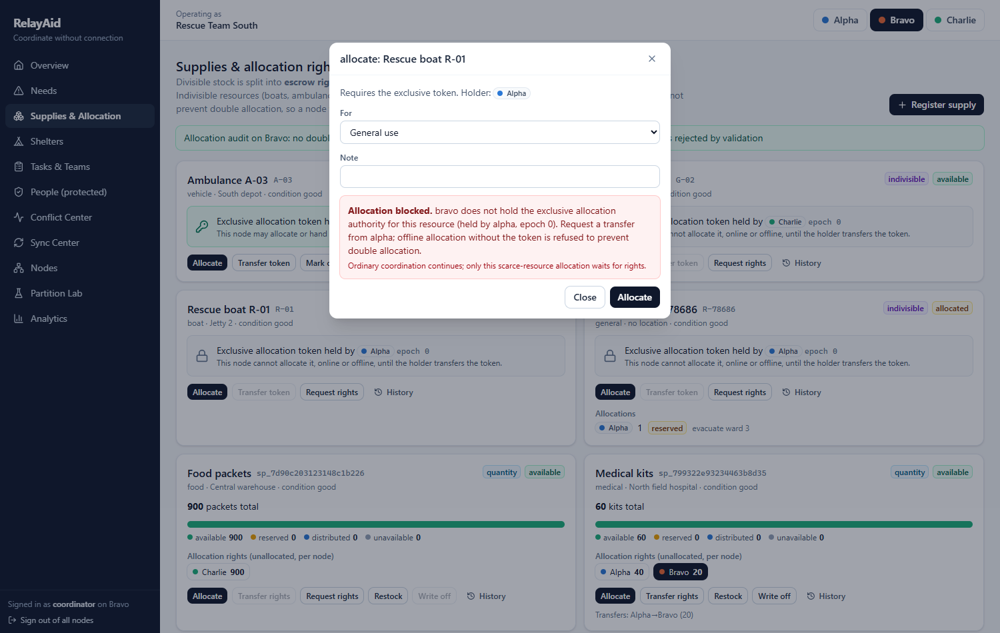
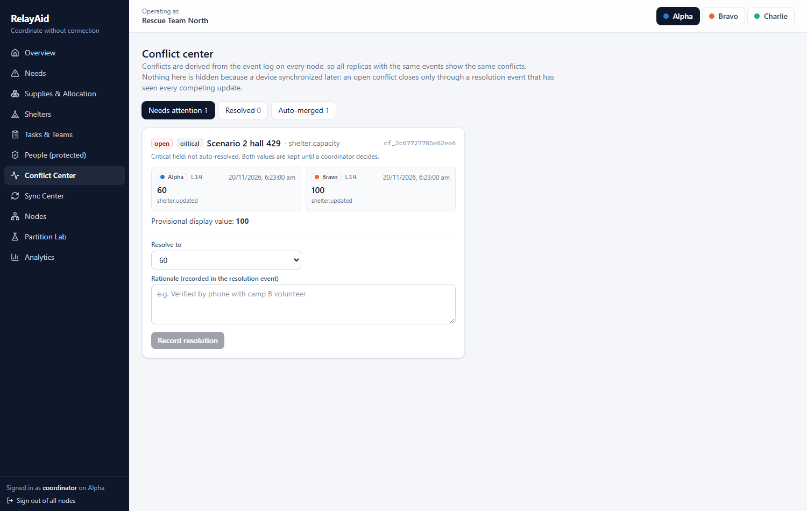
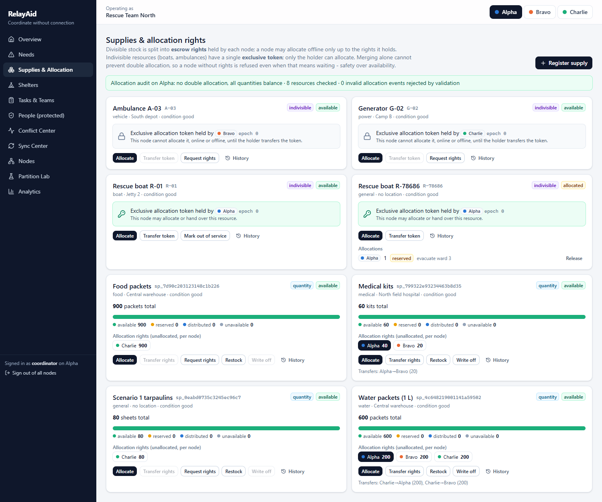

# RelayAid

**Coordinate Without Connection.** An offline-first disaster coordination platform with event-based peer-to-peer synchronization, semantic conflict resolution, escrow-based allocation of scarce resources, and encrypted handling of sensitive records.

Domain: Data Engineering & Distributed Systems



## Problem

In floods, earthquakes, conflicts and internet shutdowns, relief teams lose connectivity exactly when coordination matters most. Server-centric tools stop working; "offline modes" overwrite each other's changes on reconnect; nothing stops two disconnected teams from dispatching the same boat; and devices carrying data about missing people can be lost or seized.

## What RelayAid does

- **Works with zero connectivity.** Every team's device is a full replica with its own SQLite database, signing key and clocks. All coordination operations are local.
- **Shares updates whenever devices meet** - directly peer-to-peer, or through an optional central server - exchanging only the events the other side lacks, in signed, compressed, bounded batches that survive weak and short links.
- **Never silently loses updates.** Every change is an immutable signed event. State is a deterministic projection of the event set, so replicas with the same events are identical (verified by state digests).
- **Merges by meaning.** Notes and evidence are unioned, occupancy changes are counted, priorities escalate, progress moves forward; critical disagreements (capacity, task assignment, "found" vs "missing") stay visible as conflicts until a coordinator resolves them with a recorded rationale.
- **Prevents double allocation.** Divisible stock is split into escrow rights per team; indivisible units (boats, ambulances, generators) have one exclusive token. A team can allocate offline only what it holds - and every replica re-validates every allocation.
- **Protects sensitive data.** Person details are AES-256-GCM encrypted before entering the log; the key is unlocked only by an operator passphrase; the central server never has it.
- **Shows it, measurably.** A dashboard with a partition laboratory, guided scenarios, a convergence runner and analytics built only from measured data.

## Architecture



Each node is a separate process running the same FastAPI service. Details: [ARCHITECTURE.md](ARCHITECTURE.md) · [DISTRIBUTED_SYSTEMS_DESIGN.md](DISTRIBUTED_SYSTEMS_DESIGN.md).

## Technology stack

| Layer | Technology |
|---|---|
| Node service | Python 3, FastAPI, Pydantic v2, uvicorn |
| Storage | SQLite (one file per node, WAL) |
| Sync | HTTP + gzip, Ed25519-signed messages, version vectors, Lamport clocks |
| Crypto | `cryptography`: Ed25519, AES-256-GCM, scrypt |
| Dashboard | React 18, TypeScript, Vite, Tailwind CSS v4 |
| Tests / evaluation | pytest, FastAPI TestClient, Playwright (screenshots, PDFs) |
| Deployment | Local processes; Docker Compose files provided |

## Prerequisites

- Python 3.11+ (developed with 3.14)
- Node.js 18+ (developed with 24) and npm
- Ports 7400-7403 and 5173 free
- Optional: Docker with Compose

## Installation

```bash
git clone https://github.com/thushara-bajimar/RelayAid.git
cd RelayAid
python -m venv .venv
# Windows:  .venv\Scripts\activate      macOS/Linux:  source .venv/bin/activate
pip install -r requirements.txt
cd frontend && npm install && cd ..
```

Optional: copy `.env.example` to `.env`, or set `RELAYAID_OPERATOR_PASSPHRASE` before the first start. The local demo default is `relayaid-demo` - **demo only, change it for anything real.**

## Running

```bash
# terminal 1: provision (first run), start server + 3 nodes, load demo data
python scripts/run_cluster.py --seed

# terminal 2: dashboard
cd frontend && npm run dev
```

Open http://127.0.0.1:5173 and sign in as `coordinator` (or `responder` / `viewer`).

| Command | Purpose |
|---|---|
| `python scripts/run_cluster.py` | Start all nodes (provisions on first run) |
| `python scripts/run_cluster.py --reset --seed` | Wipe `runtime-data/`, new keys, fresh demo data |
| `python scripts/run_cluster.py --no-auto-sync` | Disable background gossip (manual sync only) |
| `python -m relayaid.serve --node alpha` (with `PYTHONPATH=backend`) | Run one node alone |
| `python scripts/bootstrap.py [--docker] [--force]` | Provision without starting |
| `python scripts/seed_demo.py` | Load demo data into running nodes |
| `cd backend && python -m pytest -q` | Run the test suite |
| `python scripts/benchmark.py [--quick]` | Measure and write `docs/results/` |
| `python scripts/capture_screenshots.py` | Regenerate screenshots (needs cluster + dashboard) |
| `python scripts/build_pdfs.py` | Rebuild the PDFs in `docs/` |

Docker (not executed in the reference environment):

```bash
docker compose run --rm bootstrap
docker compose up --build        # dashboard on http://localhost:8080
```

## Demo

The **Partition Lab** page runs the four required scenarios with a step log, and lets an evaluator cut any link, take nodes offline, add latency, loss, short sync windows, duplicate or reordered delivery, then sync in a chosen order until converged (measured).

1. **Independent offline updates** - full partition; Alpha records a need, Bravo checks people into a shelter, Charlie registers supplies; heal; all three updates on all nodes, identical digests.
2. **Conflicting edits** - Alpha sets shelter capacity 60, Bravo 100 while partitioned; after syncing in a different order, capacity is an open critical conflict with both candidates, while the LWW `conditions` field merges deterministically and is recorded.
3. **Double allocation attempt** - boat token held by Alpha; partitioned Alpha allocates; Bravo is refused with an explanation; after sync exactly one allocation exists everywhere.
4. **Repeated partitions** - split, partial reconnects, re-split, third node rejoins through another; repeated sync converges with all updates preserved.

| Partition Lab | Allocation refused offline |
|---|---|
|  |  |

| Conflict Center | Supplies, rights and tokens |
|---|---|
|  |  |

More screenshots in [docs/screenshots](docs/screenshots).

## Resource allocation safety

CRDT merging guarantees agreement, not safety: two disconnected nodes can both "allocate the last boat" and a merge cannot undo that. RelayAid therefore uses **escrow rights** (quantities: a node spends only rights in its causal past) and **exclusive tokens with epochs** (indivisible units: only the current holder may allocate or hand over). Both are checked locally and re-validated by every replica. The cost is intentional: a node without rights waits or requests them, while all other coordination continues.

## Security features

Ed25519 device identities and signed events; signed, timestamped, nonce-protected peer requests and signed responses; strict payload schemas; scrypt-hashed operator passphrases with lockout; expiring sessions; coordinator/responder/viewer roles enforced in the API; AES-256-GCM field encryption bound to record and field; data key unlocked only at login and never given to the server; logs and audit trail without personal data. Limits are documented honestly in [SECURITY_AND_PRIVACY.md](SECURITY_AND_PRIVACY.md) (e.g. loopback HTTP in the MVP, coordination data not encrypted at rest).

## Testing and results

65 automated tests (`backend/tests`), all passing: offline operation, synchronization, conflict preservation, convergence under randomized partitions, allocation safety (including forged events), and security. Measured results are in [TESTING_AND_EVALUATION.md](TESTING_AND_EVALUATION.md) and `docs/results/`.

## Documentation

| Document | Content |
|---|---|
| [TECHNICAL_DOCUMENTATION.md](TECHNICAL_DOCUMENTATION.md) | Complete technical report |
| [ARCHITECTURE.md](ARCHITECTURE.md) | Components, data flow, sync, event processing |
| [DISTRIBUTED_SYSTEMS_DESIGN.md](DISTRIBUTED_SYSTEMS_DESIGN.md) | Causality, merge strategy, convergence, escrow, trade-offs |
| [SECURITY_AND_PRIVACY.md](SECURITY_AND_PRIVACY.md) | Threat model and protections |
| [API_DOCUMENTATION.md](API_DOCUMENTATION.md) | Endpoints and peer protocol |
| [TESTING_AND_EVALUATION.md](TESTING_AND_EVALUATION.md) | Methodology and measured results |
| [CONTRIBUTING.md](CONTRIBUTING.md) | Development workflow |
| [PRESENTATION_CONTENT.md](PRESENTATION_CONTENT.md) | 12-slide presentation content |
| `docs/RelayAid_Technical_Documentation.pdf`, `docs/RelayAid_Project_Report.pdf` | PDF deliverables |

## Limitations

Laptop-scale MVP: nodes communicate over loopback HTTP; peers are provisioned, not discovered; the projection is fully recomputed per change (fine for thousands of events, not millions); no log compaction; coordination data is not encrypted at rest; device keys are not hardware-protected and cannot be revoked online; all nodes must run the same schema version; Docker files are untested here. See the limitations sections of the technical documentation.

## Future scope

Mobile clients over Bluetooth / Wi-Fi Direct / LoRa, QR-code pairing, TLS/mTLS, SQLCipher and hardware keystores, snapshots and compaction, rights leases and rebalancing, token recovery, map views, SMS bridges.

## License

No license has been chosen yet; all rights reserved by the authors until one is added.
