# RelayAid - Technical Documentation

**Coordinate Without Connection.** Offline-first disaster coordination and resilient data synchronization.

Domain: Data Engineering & Distributed Systems · Version 1.0.0

---

## 1. Abstract

When networks fail during floods, earthquakes, conflicts or deliberate shutdowns, relief teams still need to share what is needed, where shelters have space, which supplies remain, and who has been found. Most coordination tools assume a reachable server; without one they stop or silently overwrite each other's updates when connectivity returns, and they cannot stop two disconnected teams from dispatching the same scarce resource.

RelayAid is an offline-first coordination platform in which every device is an independent replica with its own database, identity and clocks. Every change is a signed, append-only event. Devices exchange only the events they lack - directly with each other or through an optional central server - using a version-vector anti-entropy protocol with bounded, compressed, authenticated batches. State is a deterministic projection of the event set, so replicas that hold the same events are provably identical. Field-specific merge policies (last-writer-wins, lattices, multi-value registers, counters and grow-only sets) preserve concurrent updates, while critical disagreements - such as a person reported both *found* and *missing* - are kept side by side as visible conflicts until a coordinator resolves them. Scarce resources are protected with escrow rights for divisible stock and exclusive epoch tokens for indivisible units, re-validated on every replica, so double allocation is impossible even under partitions. Sensitive person data is encrypted per field with AES-256-GCM before it enters the log, and the central server never holds the key.

The MVP runs a server and three field nodes as separate processes on one laptop, with a React dashboard and a partition laboratory. 65 automated tests and a measured benchmark suite (Section 28) cover offline operation, synchronization, convergence under randomized partitions, conflict preservation, allocation safety and security.

## 2. Introduction

Disaster response is a distributed system whether or not the software admits it: teams act on partial information, communicate opportunistically, and must reconcile later. RelayAid takes this seriously by making the device - not the server - the primary home of data, and by treating synchronization, conflict handling and resource safety as first-class engineering problems rather than features bolted onto a CRUD application.

This document describes the requirements, design, implementation, and measured behaviour of the MVP, and states precisely which properties are guaranteed, under which assumptions, and which are not.

## 3. Problem statement

During a communication blackout:

1. Teams must keep recording needs, supplies, shelters, tasks and people updates **locally**.
2. When devices meet (or the server becomes reachable), updates must **merge without loss**.
3. Concurrent updates to the same record must not be **silently overwritten**; critical ones must be **surfaced**.
4. Two disconnected teams must not **allocate the same scarce resource**.
5. Sensitive personal data must remain **protected** on lost or seized devices and on the server.
6. Synchronization must work over **short, slow, lossy** links.

## 4. Existing approaches and their limitations

| Approach | Limitation in a blackout |
|---|---|
| Central web apps / spreadsheets | Unusable without connectivity; no local write path |
| "Offline mode" with sync-on-reconnect (row upload, last write wins) | Silent overwrites; lost concurrent updates; no conflict visibility |
| Document sync (CouchDB-style revision trees) | Detects conflicts but leaves semantics to the app; no allocation safety |
| Generic CRDT libraries | Guarantee convergence, but a merge cannot un-dispatch a boat: no prevention of double allocation; generic types do not encode "critical field" semantics |
| Consensus (Raft/Paxos) or distributed locks | Need a reachable majority; stop working exactly when partitions happen |
| Messaging apps (mesh chat) | Unstructured; no shared state, no resource accounting |

## 5. Proposed solution

- **Independent replicas** with local SQLite databases and Ed25519 identities.
- **Event sourcing** with Lamport clocks and version vectors on every event.
- **Anti-entropy synchronization** that is incremental, causally ordered, idempotent, batched, compressed, authenticated and resumable.
- **Deterministic projection** with per-field merge semantics and derived, replicated conflict records.
- **Escrow rights and exclusive tokens** for scarce resources, validated on every replica.
- **Field-level encryption** of person data with keys unlocked only by operator login.
- **Partition laboratory** and **measured analytics** to demonstrate and evaluate the above.

## 6. Objectives

1. Operate without any connectivity. 2. Support at least three independent nodes. 3. Record needs, supplies, shelters, tasks and people. 4. Synchronize peer-to-peer. 5. Synchronize with a server when reachable. 6. Never silently lose conflicting updates. 7. Prevent double allocation. 8. Protect sensitive records. 9. Minimize sync payloads. 10. Converge after repeated partitions. 11. Measure sync performance and convergence. 12. Explain conflicts and keep audit history.

## 7. Scope

**In scope:** laptop-scale demo with one server and three field nodes as separate processes; HTTP over loopback as the transport; manual (provisioned) peer configuration; dashboard; automated tests; benchmarks; Docker Compose files.

**Out of scope (documented as future work):** mobile apps, radio transports (Bluetooth, Wi-Fi Direct, LoRa), automatic peer discovery, TLS deployment, log compaction, online key revocation, multi-deployment federation.

## 8. Functional requirements

| ID | Requirement | Implementation |
|---|---|---|
| FR1 | Create/update needs with category, description, quantity, unit, priority, location, status, team, notes, history | `need.*` events, Needs page |
| FR2 | Register supplies; restock; write off; distinguish available/reserved/allocated/distributed/unavailable | `supply.*` events, Supplies page |
| FR3 | Allocate resources safely offline; transfer and request rights; allocation history | Escrow/token logic, `supply.allocated/transferred/...` |
| FR4 | Register shelters; capacity, occupancy, conditions, accessibility, status, history | `shelter.*` events |
| FR5 | Protected people records: missing/located/found/reunited/needs assistance/unknown; evidence; verification | `person.*` events (encrypted), People page |
| FR6 | Teams and tasks: creation, assignment, status, notes, completion | `team.*`, `task.*` events |
| FR7 | Peer-to-peer and server synchronization, manual and automatic | `sync.py`, Sync Center |
| FR8 | Conflict detection, preservation, explanation, resolution, audit | projection conflicts, Conflict Center |
| FR9 | Partition simulation: disconnect, reconnect, server down, latency, loss, windows, duplicates, ordering | `netsim.py`, Partition Lab |
| FR10 | Metrics: sessions, payload sizes, events, duplicates, failures, retries, conflicts, blocked allocations | `metrics()`, Analytics |

## 9. Non-functional requirements

| Category | Requirement |
|---|---|
| Availability | All coordination operations work with zero connectivity |
| Safety | No double allocation of scarce resources under any partition |
| Consistency | Replicas with equal event sets have equal state; no silently lost updates |
| Security | Authenticated peers; signed events; replay protection; role-based access; encrypted person data |
| Efficiency | Incremental sync; bounded, compressed batches; resumable sessions |
| Portability | Runs on a laptop with Python and Node; no paid services; no internet needed at runtime |
| Explainability | Conflicts and refusals explain themselves; full event history per record |

## 10. Offline-first architecture

The node's local database is the system of record for that team. A write is: authenticate operator → validate → build and sign event → insert into the local log → rebuild local state. No network call is on this path (`Node.append_local`). The network only moves events between logs (`SyncEngine`). See [ARCHITECTURE.md](ARCHITECTURE.md) for diagrams.

## 11. Distributed architecture

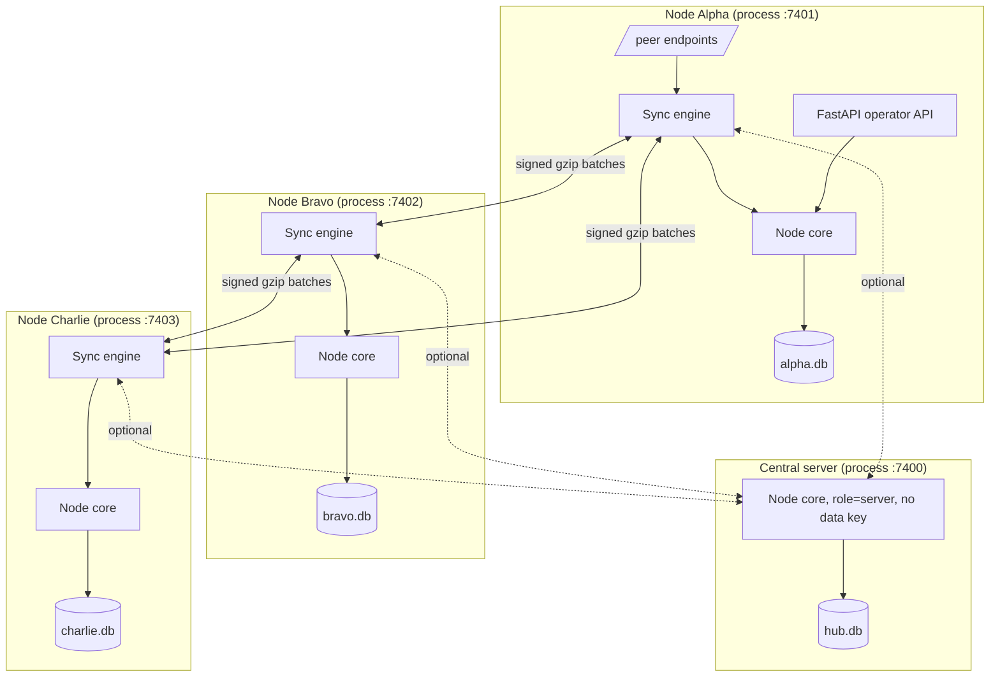

All four processes run identical code; the server differs only in role (no operators, no DEK, no originating writes).

## 12. Node architecture

| Layer | Responsibility |
|---|---|
| API (`api.py`) | Session auth, role checks, request validation, peer endpoint authentication, link enforcement |
| Node core (`node.py`) | Domain operations and their safety checks, event creation, ingestion, queries, digest |
| Event model (`events.py`) | Envelope, payload schemas, signing, verification |
| Projection (`projection.py`) | Deterministic fold, merge policies, conflicts, allocation validation |
| Storage (`db.py`) | SQLite schema, transactions, counters |
| Sync (`sync.py`) | Protocol client/server, retries, backoff, metrics, gossip loop |
| Security (`security.py`, `crypto.py`) | Sessions, request/response signatures, nonce cache, AES-GCM, scrypt |
| Simulator (`netsim.py`) | Per-node link and quality settings |

In memory, each node keeps its events sorted by `(lamport, origin, seq)` with an index for bisection, its contiguous version vector, and its current projection.

## 13. Event-based data architecture

Every state change is one of 32 event types (`events.PAYLOAD_SCHEMAS`), e.g. `need.created`, `need.updated`, `need.note_added`, `supply.registered`, `supply.rights_transferred`, `supply.token_transferred`, `supply.allocated`, `supply.allocation_released`, `supply.distributed`, `supply.written_off`, `supply.rights_requested`, `shelter.occupancy_changed`, `person.reported`, `person.status_updated`, `person.verified`, `task.assigned`, `task.status_changed`, `conflict.resolved`, `conflict.acknowledged`. Events are never updated or deleted. Materialized tables are caches that can always be rebuilt from the log.

## 14. Database design

Each node owns one SQLite database in WAL mode.

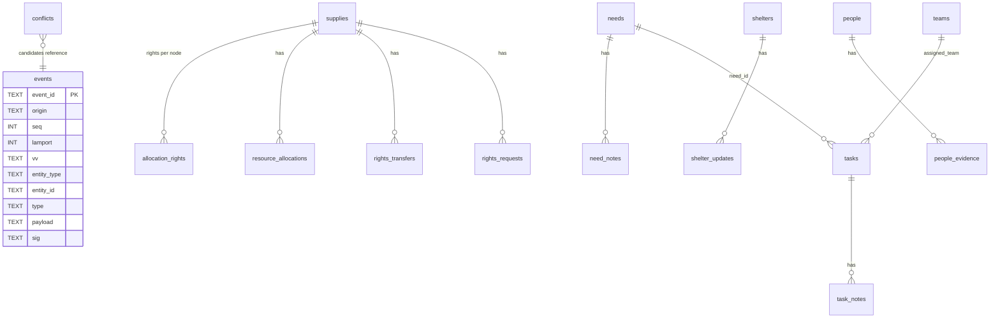

| Group | Tables | Notes |
|---|---|---|
| Replicated source of truth | `events` | PK `event_id`; `UNIQUE(origin, seq)`; indexes `(lamport, origin, seq)` and `(entity_type, entity_id)` |
| Local node state | `meta`, `peer_state`, `sync_sessions`, `sim_state`, `audit_log`, `counters` | Never replicated |
| Materialized projections | `teams`, `needs`, `need_notes`, `supplies`, `allocation_rights`, `rights_transfers`, `resource_allocations`, `rights_requests`, `shelters`, `shelter_updates`, `people`, `people_evidence`, `tasks`, `task_notes`, `conflicts`, `rejected_events` | Child tables reference parents with `ON DELETE CASCADE` foreign keys; all rebuilt from `events` |

Schema versioning: `meta.schema_version` for the database and `schema` in each event for payloads.

## 15. Data model

| Entity | Key fields | Merge policy |
|---|---|---|
| Team | name, specialty, members, home_node | LWW |
| Need | category, description, quantity, unit, priority, location, status, responsible_team, notes | LWW; priority = max lattice; status = critical; notes = G-set |
| Supply | name, category, kind, unit, location, condition, total, rights per node, holder, epoch, allocations, transfers, requests | metadata LWW; quantities by escrow; indivisible by token |
| Shelter | name, location, capacity, occupancy, accessibility, conditions, status, updates | capacity/status critical; occupancy PN-counter; others LWW; invariant occupancy ≤ capacity |
| Person | status, verification, reporting_team, encrypted fields, evidence | status critical; evidence G-set; verification derived |
| Task | title, description, priority, location, need_id, assigned_team, status, notes | assigned_team critical; status lattice; priority max; others LWW |
| Conflict | kind, entity, field, policy, status, candidates, current value, resolution | derived from events |

## 16. Event structure

| Field | Type | Purpose |
|---|---|---|
| `event_id` | string | Global, stable id for idempotent processing |
| `origin` | node id | Author; selects the verification key |
| `seq` | int ≥ 1 | Per-origin contiguous counter |
| `lamport` | int | Logical time for causal total order |
| `vv` | map | Origin's causal knowledge including this event |
| `entity_type`, `entity_id` | string | Record addressed |
| `type` | string | One of 32 schema-checked event types |
| `payload` | object | Validated, canonical; ≤ 16 KB; sensitive fields ciphertext |
| `created_at` | ISO time | Display only |
| `schema` | int | Payload schema version |
| `sig` | base64 | Ed25519 signature over all other fields (canonical JSON) |

## 17. Synchronization protocol

Three signed, gzip-compressed message types (full specification in [API_DOCUMENTATION.md](API_DOCUMENTATION.md#peer-protocol)):

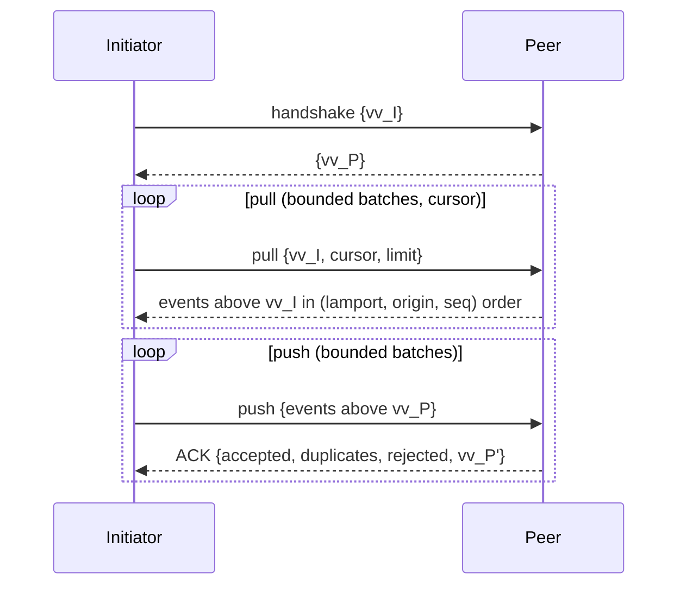

Failure handling: up to 3 retries per request with exponential backoff (`backoff_base · 2^attempt`); per-peer exponential delay of the next automatic attempt (2 → 60 s); sessions are `success`, `partial`, `failed` or `link_down`; every session is recorded with counts, sizes, retries and duration.

## 18. Peer-to-peer communication

Nodes call each other's `/peer/*` endpoints directly using roster URLs; no discovery or relay server is involved. Peers are provisioned together ("pairing") by `scripts/bootstrap.py`, which distributes public keys in `deployment.json`. A background gossip loop syncs with every reachable peer every 5 s by default; operators can also sync on demand. Limitation: discovery is manual (roster); QR-code pairing is future work.

## 19. Central server synchronization

The server is a replica that never initiates field records. Nodes sync with it exactly as with peers; because it stores everything, it bridges teams that never meet (`test_sync_through_central_server`). The server runs its own gossip loop and pushes what it has learned to reachable nodes. Without the server, nothing local stops working (`test_node_operates_fully_offline_without_server`).

## 20. Incremental synchronization and idempotency

- Diffing by version vectors: only `seq > vv[origin]` is sent.
- Pagination by `(lamport, origin, seq)` cursor keeps each message bounded and each received prefix causally closed.
- Idempotency by `event_id`; equivocation detection on `(origin, seq)`; ids for allocations, transfers, notes, requests embedded in events.
- Measured: see Section 28, E1 (payload per event, size of a no-op sync, incremental single-event sync).

## 21. Conflict resolution and convergence

**CRDT concepts used:** LWW-register, max-register/lattice, multi-value register, PN-counter, G-set (details and rationale in [DISTRIBUTED_SYSTEMS_DESIGN.md](DISTRIBUTED_SYSTEMS_DESIGN.md#7-merge-strategy-crdt-concepts-per-field)).

**Causal metadata:** `happened_before(a, b) ⇔ b.vv[a.origin] ≥ a.seq`. Each field register keeps a frontier of writes not causally superseded; more than one distinct value means concurrent disagreement.

**Conflict records** are derived deterministically (stable ids from entity, field and candidate ids) and therefore identical on all replicas with the same events. Critical conflicts stay `open` until a causally dominating write (`conflict.resolved` with rationale, or a deliberate update) - so a late-arriving concurrent write extends the conflict rather than being hidden.

**Convergence** follows from determinism of the fold over an order (`lamport, origin, seq`) that depends only on the event set; it is verified by comparing SHA-256 digests of all materialized tables across replicas (tests in Section 27, measurements in Section 28).

## 22. Resource allocation safety

**Escrow rights (divisible).** Registering node receives rights = quantity. A node may spend (allocate, transfer, write off) only `credits in the causal past of the spending event − own previous debits`. Transfers are paid by the sender first. Hence Σ allocated ≤ stock in every execution.

**Exclusive tokens (indivisible).** Holder + epoch per unit. Only the holder at the current epoch may allocate, change availability or transfer; transfers increment the epoch and are refused while allocated. At most one node holds the token in any causal history ⇒ at most one active allocation.

**Allocation-right transfer.** Recorded as an event with a unique id, idempotent on redelivery, optionally answering a rights request.

**Defence in depth.** The local API refuses with an explanation (HTTP 409, counted as `allocations_blocked`); the projection re-validates every rights-spending event on every replica and rejects invalid ones into `rejected_events`, which neutralises buggy or misbehaving nodes even when their events are validly signed.

**Availability trade-off.** A node without rights cannot allocate while offline; this is intentional. Ordinary coordination continues. Rights can be pre-distributed and requested.

**Partition behaviour.** See [DISTRIBUTED_SYSTEMS_DESIGN.md §10](DISTRIBUTED_SYSTEMS_DESIGN.md#10-network-partition-behaviour).

## 23. Security and privacy

Summary (full threat model in [SECURITY_AND_PRIVACY.md](SECURITY_AND_PRIVACY.md)):

| Mechanism | Implementation |
|---|---|
| Device identity | Ed25519 key per node; roster of public keys |
| Peer authentication | Signed requests (method, path, timestamp, nonce, body hash); signed responses bound to nonce |
| Replay protection | ±120 s window + nonce cache; idempotent ingestion |
| Event integrity | Origin signature on every event; strict schema validation |
| Operator auth | scrypt-hashed passphrases, expiring bearer sessions, lockout, roles coordinator/responder/viewer |
| Encryption | AES-256-GCM per sensitive field, AAD-bound to record and field; DEK wrapped by scrypt(passphrase); server never holds DEK |
| Data minimization | People absent from overview; redacted feeds; audit/logs store ids only |
| Lost device | Locked node: person data unreadable without passphrase; documented limits for coordination data and device keys |
| Transport | HTTP on loopback in the MVP (documented exception); TLS required for real networks |

## 24. API documentation

See [API_DOCUMENTATION.md](API_DOCUMENTATION.md) for every endpoint, request/response formats, error codes and the peer protocol. Each running node also serves OpenAPI docs at `/docs`.

## 25. Implementation details

- **Language/runtime:** Python 3.14, FastAPI, Pydantic v2, uvicorn, SQLite (stdlib), httpx, cryptography.
- **Concurrency:** one SQLite connection per node guarded by a re-entrant lock; FastAPI runs synchronous endpoints in a thread pool; a daemon thread runs gossip; per-peer locks avoid overlapping sessions with the same peer.
- **Projection rebuild:** full refold after each local write or ingested batch, inside one transaction (`Projection.write`).
- **Local checks mirror projection validation:** rights available to the node are computed with a probe event carrying the node's next version vector through the same `rights_known` function the projection uses; the randomized convergence test asserts that no locally created event is ever rejected by the projection.
- **Network simulation:** persisted per node; enforced on both sender and receiver.
- **Provisioning:** `create_deployment()` writes keys, roster and wrapped keys; the launcher provisions on first run.
- **Size:** backend ~3,500 lines of Python, tests ~1,100, frontend ~2,100 lines of TypeScript (counted with `wc -l`).

## 26. Frontend architecture

React 18 + TypeScript + Vite + Tailwind CSS v4, system fonts only (works offline). `api.ts` holds a per-node session map (sessionStorage) and a typed request helper; the Vite proxy maps `/n/<node>/...` to each node's port. A context provides the active node, toasts and a refresh tick; `usePoll` refreshes data every few seconds. Pages: Overview, Needs, Supplies & Allocation, Shelters, Tasks & Teams, People (protected), Conflict Center, Sync Center, Nodes, Partition Lab, Analytics. Authorization is enforced server-side; the UI only reflects it.

## 27. Testing methodology

The `cluster` fixture builds a real four-node deployment per test: separate SQLite files and FastAPI apps; peer HTTP is routed through FastAPI's TestClient, so request signing, gzip, replay checks and link simulation all run. Assertions compare converged state (digests), event-id sets and preserved history, not only status codes.

| File | Tests | Focus |
|---|---|---|
| `test_offline_and_sync.py` | 12 | Offline operation, restart persistence, P2P without server, server relay, incremental, batching, duplicates, retry/backoff, partial windows, receiver-side partition, shuffled delivery, metrics |
| `test_conflicts.py` | 13 | LWW determinism, note preservation, priority lattice, found-vs-missing, persistence of open conflicts, explicit resolution, resolution races, occupancy counter and invariant, task assignment/status, merge-order independence (3 orders) |
| `test_convergence.py` | 11 | Scenarios 1 and 4, six randomized partition runs with duplicates/shuffles, arrival-order independence via replay, conflict-set convergence, vector-clock semantics |
| `test_allocation_safety.py` | 12 | Scenario 3, token transfer, duplicate transfers, forged allocations, stale transfers, release/request workflow, quantity limits, sender reuse, duplicate events, forged overspend, causal rights, accounting |
| `test_security.py` | 17 | Peer auth, replay, stale timestamps, tampering, malicious payloads, plaintext refusal, RBAC, at-rest encryption, server opacity, log hygiene, lockout, expiry, lock, AAD binding, impostor responses |

## 28. Experimental results

Measured on the reference laptop (Windows 11, Python 3.14). Full tables and methodology: [TESTING_AND_EVALUATION.md](TESTING_AND_EVALUATION.md); raw data: `docs/results/benchmark_results.json`.

**Automated tests:** 65 / 65 passed.

| Experiment | Setup | Result |
|---|---|---|
| E1 Payload | N events Alpha → Bravo | ~129 wire bytes/event in bulk (3.9× smaller than raw JSON); one-event sync ~660 B; no-op sync ~320 B and 21-31 ms, independent of history size |
| E2 Convergence | 3-way partition, 20 or 100 updates per node, 4 sync orders, 5 trials each | 40/40 converged with no lost updates; mean 317-789 ms (ring orders), 446-1,209 ms (via server); 2 rounds (3 via server) |
| E3 Chaos | 25 seeds of random partitions, duplicates, shuffles, small batches and short windows | 25/25 converged; 25/25 identical event sets; 25/25 identical conflict sets; 1,021 duplicates ignored |
| E4 Allocation safety | 300 random allocation steps under random partitions + 10 forged events | 216 refusals, 51 accepted, 0 double allocations, kits 300/300 never exceeded, 10/10 forged events rejected by every replica, audit OK on all nodes |
| E5 Duplicates | every batch delivered twice | 400 duplicates ignored, state identical (200 needs per node) |
| E6 Lossy links | 10 / 30 / 50 % request loss | 15/15 converged; session success 100 / 95 / 80 %; 23 / 70 / 157 retries |
| E7 Rebuild cost | 100 / 1,000 / 3,000 events | median full rebuild 9.6 / 110 / 312 ms (linear) |
| E8 Real processes | 4 OS processes, loopback HTTP, 50 updates per node | converged in 2 rounds, 394 ms after healing, 40.6 KB on the wire; 8.4 ms mean local write |

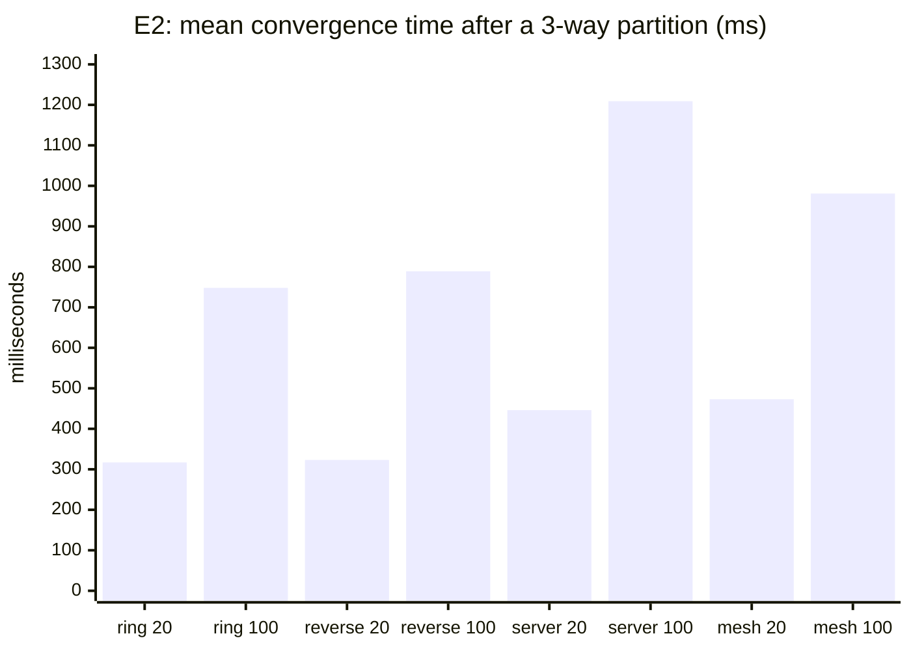

**Performance analysis.** Synchronization cost scales with the number of *new* events, not with history size (E1). Convergence after a partition needs two rounds in any connected order (three when all traffic goes via the server, which also moves 50 % more events). Under loss, retries and resumable batches keep convergence intact at the cost of more sessions (E6). The dominant cost in the MVP is the full projection rebuild, which grows linearly at about 0.1 ms per event (E7); this sets the practical limit of the current design at a few thousand events per deployment before snapshots or incremental folding are required.

## 29. Screenshots

| | |
|---|---|
| Overview with digest-based convergence check | 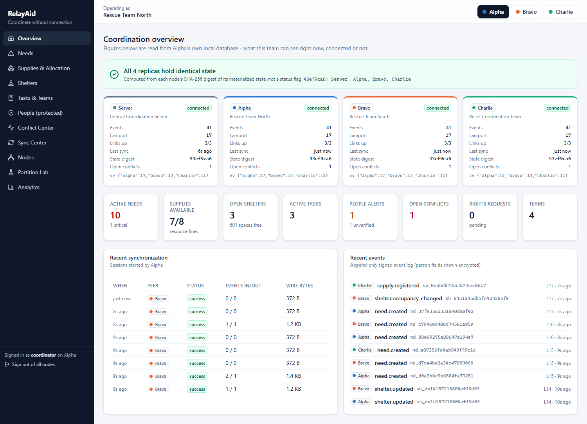 |
| Supplies with escrow rights and tokens | 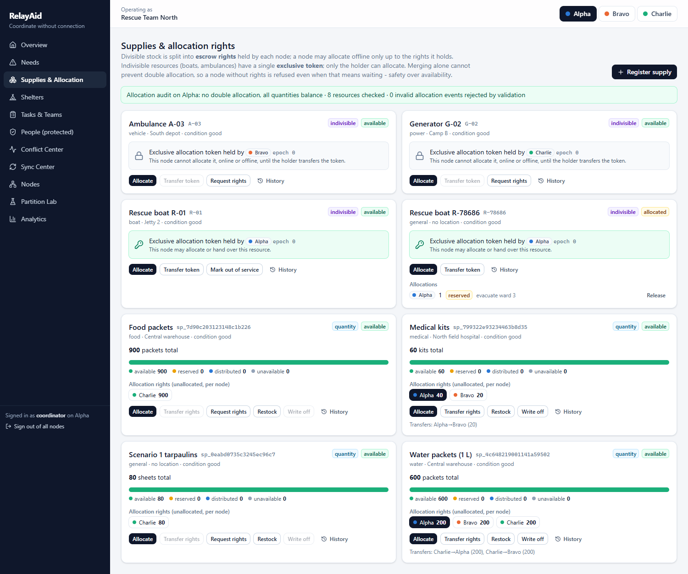 |
| Allocation blocked on Bravo (no token) | 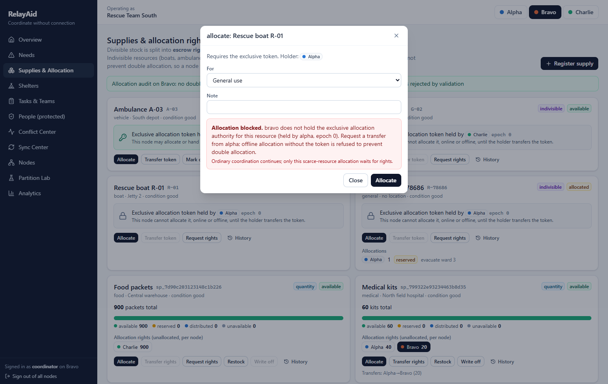 |
| Conflict Center (critical capacity conflict) | 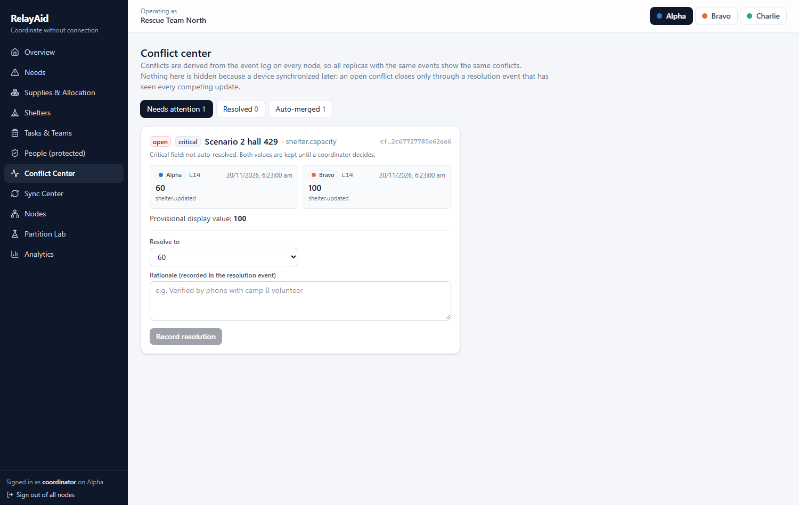 |
| Partition Lab with Charlie isolated | 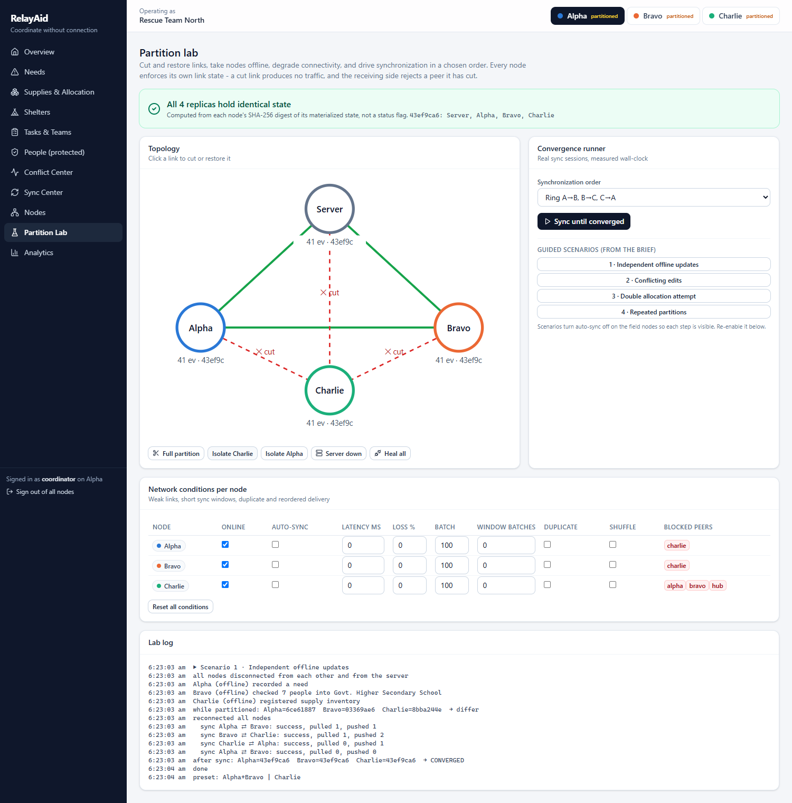 |
| Scenario 3 log | 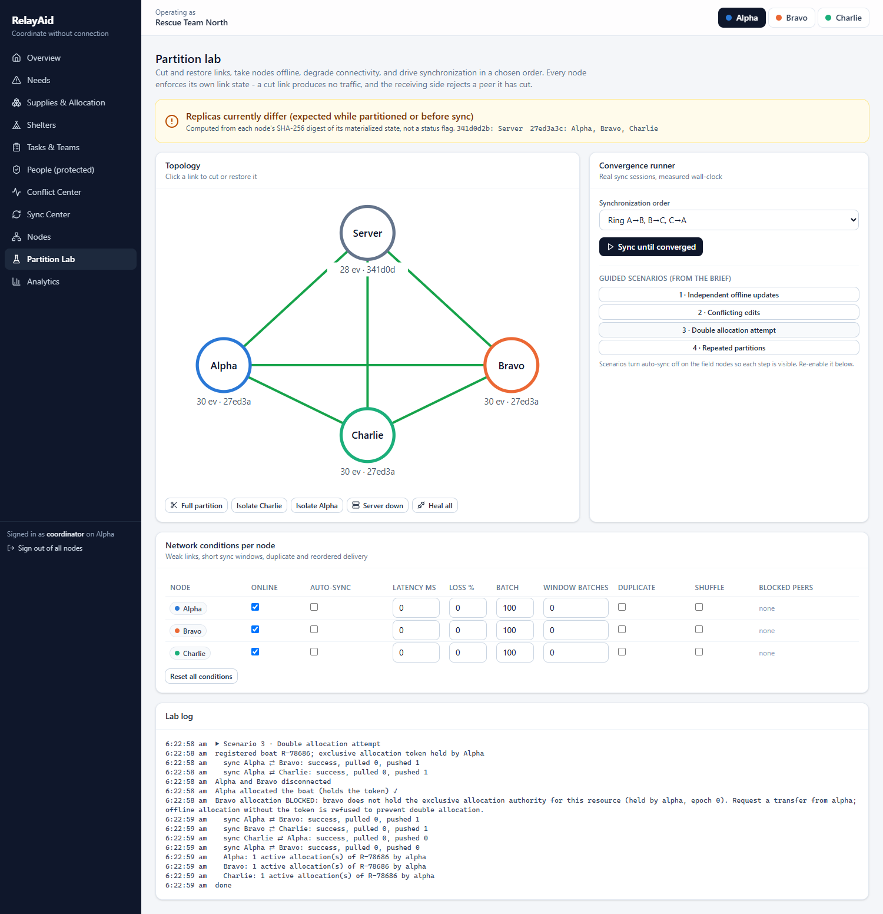 |
| Sync Center | 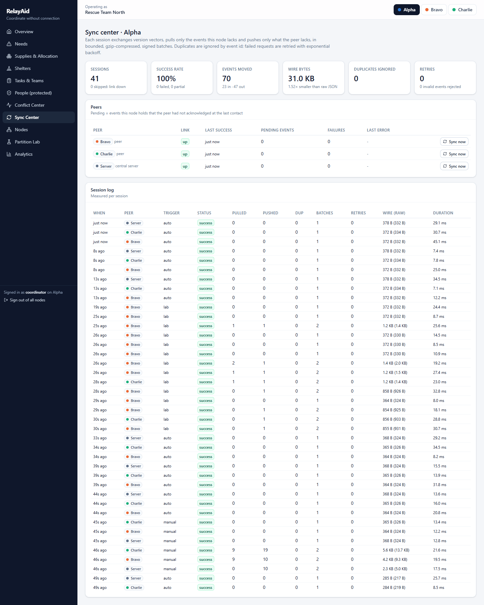 |
| Analytics | 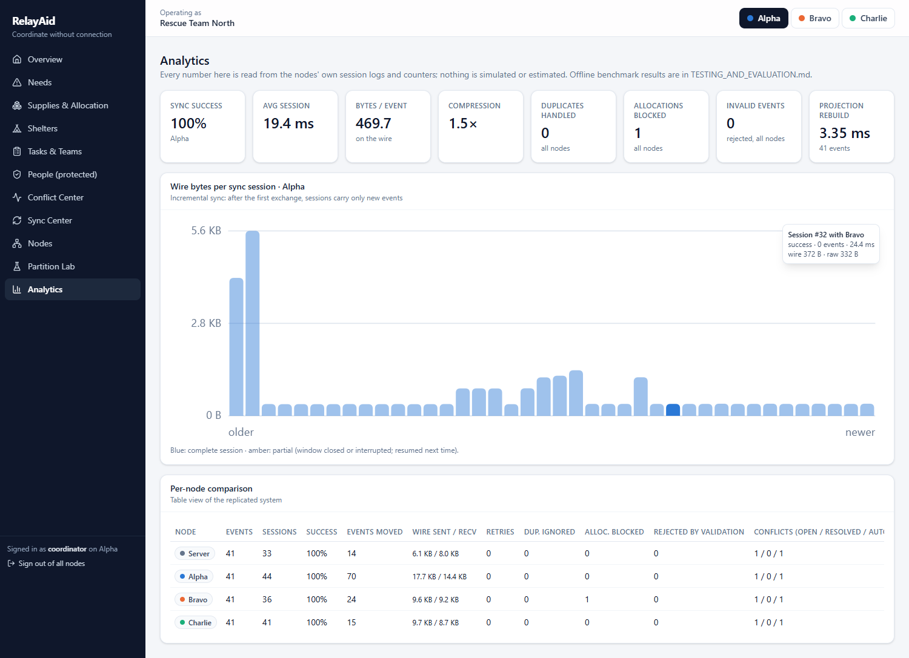 |
| People as responder (redacted) | 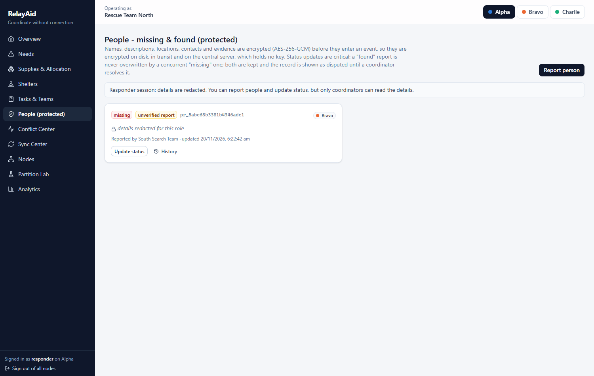 |

## 30. Limitations

- Full refold per write: O(n); measured cost in E7. No snapshots or compaction.
- Event log grows without bound; version vectors grow with node count.
- Plain HTTP between nodes in the MVP; coordination data unencrypted in transit and at rest.
- Device signing keys are files protected only by OS permissions; no online revocation.
- Demo passphrase is public; real deployments must set their own.
- LWW drops a concurrent non-critical value from current state (kept in history and conflict records).
- Occupancy counter assumes deltas; concurrent recounts double-adjust (surfaced by the capacity invariant).
- Escrow can block an allocation that global knowledge would allow; a token is stuck if its holder device is destroyed.
- All nodes must run the same schema version.
- Docker Compose files were not executed in the reference environment.
- Benchmarks E1-E7 run in-process (ASGI transport); only E8 crosses real sockets, all on one machine.

## 31. Future scope

Mobile clients with Bluetooth / Wi-Fi Direct / LoRa transports; QR-code pairing and roster updates by signed events; TLS/mTLS with roster-pinned keys; SQLCipher and hardware keystores; incremental projection, snapshots and compaction; rights leases and automatic rebalancing; coordinator-signed token recovery; map view; SMS/USSD bridges when partial connectivity exists; schema upcasting.

## 32. Conclusion

RelayAid shows that disaster coordination can continue through network failure without sacrificing data integrity. Treating every device as a replica, every change as a signed event and state as a deterministic projection yields measurable convergence after arbitrary partitions; field-specific merge semantics keep critical disagreements visible instead of silently resolving them; and escrow rights with exclusive tokens deliver a guarantee that merging alone cannot - no double allocation of scarce resources - at the clearly stated cost of reduced availability for those resources only.

## 33. References

1. L. Lamport, "Time, Clocks, and the Ordering of Events in a Distributed System," *Communications of the ACM*, 21(7), 1978.
2. M. Shapiro, N. Preguiça, C. Baquero, M. Zawirski, "Conflict-free Replicated Data Types," *SSS 2011*, LNCS 6976.
3. D. S. Parker et al., "Detection of Mutual Inconsistency in Distributed Systems," *IEEE TSE*, SE-9(3), 1983 (version vectors).
4. P. E. O'Neil, "The Escrow Transactional Method," *ACM TODS*, 11(4), 1986.
5. S. Gilbert, N. Lynch, "Brewer's Conjecture and the Feasibility of Consistent, Available, Partition-Tolerant Web Services," *SIGACT News*, 33(2), 2002.
6. M. Kleppmann, A. Wiggins, P. van Hardenberg, M. McGranaghan, "Local-First Software: You Own Your Data, in Spite of the Cloud," *Onward! 2019*.
7. A. Demers et al., "Epidemic Algorithms for Replicated Database Maintenance," *PODC 1987* (anti-entropy).
8. RFC 8032, "Edwards-Curve Digital Signature Algorithm (EdDSA)"; NIST SP 800-38D (GCM); RFC 7914 (scrypt).
9. Documentation of FastAPI, Pydantic, SQLite (WAL mode), the Python `cryptography` package, React and Vite.
