# Abstract

Disasters and internet shutdowns remove the connectivity that coordination software depends on, exactly when relief teams most need to share what is needed, where shelter space exists, which supplies remain and who has been found. RelayAid is an offline-first coordination platform in which every team device is an independent replica that keeps working with no network at all, and that exchanges updates directly with other devices - or through an optional server - whenever a link appears.

Every change is an immutable, signed event carrying a Lamport clock and a version vector. Replicas exchange only the events the other side lacks, in bounded, compressed, authenticated batches. State is a deterministic projection of the event set, with merge rules chosen per field: descriptive fields merge automatically, counters and notes accumulate, and critical disagreements - such as a person reported both *found* and *missing* - remain visible as conflicts until a coordinator resolves them. Scarce resources are protected by escrow rights and exclusive tokens, so two disconnected teams can never allocate the same boat or more medical kits than exist. Sensitive person data is encrypted before it enters the log.

The MVP runs a server and three field nodes as separate processes with a React dashboard. All 65 automated tests pass. In measured experiments, 40 of 40 partitioned trials and 25 of 25 randomized chaos runs converged with no lost updates; 216 unsafe allocation attempts were refused with zero double allocations; ten forged allocation events were rejected by every replica; and four real processes converged 394 ms after a partition healed.

# Introduction

Relief work in a disaster is inherently distributed: separate teams act on partial information and communicate only when they can. Mainstream tools hide this behind a central server and fail when it is unreachable. RelayAid instead makes each device the home of its team's data and treats synchronization, conflicting updates, scarce-resource safety and data protection as the core engineering problems.

The project was built as a working system rather than a mock-up: real independent processes and databases, a real synchronization protocol, real conflict records, real cryptography, and measurements taken from running code.

# Problem Statement

When the network dies, coordination systems must:

1. let teams record and update information locally;
2. merge updates later without losing any;
3. avoid silently overwriting concurrent updates, and surface critical disagreements;
4. prevent two disconnected teams from allocating the same scarce resource;
5. protect sensitive personal data on devices that may be lost or seized, and on the server;
6. synchronize efficiently over slow, unreliable, short-lived links.

Existing approaches either require connectivity (central apps, consensus, locks), lose updates (last-write-wins row sync), or guarantee only eventual agreement (generic CRDTs), which cannot prevent a double dispatch that has already happened.

# Objectives

- Operate fully offline with at least three independent nodes and an optional server.
- Support needs, supplies, shelters, tasks and protected people records.
- Synchronize incrementally peer-to-peer and through the server.
- Detect, preserve and explain conflicts; resolve deterministically where safe.
- Prevent double allocation of scarce resources under partitions.
- Protect sensitive records with encryption and access control.
- Demonstrate and measure convergence, payload size, safety and resilience.

# Methodology

The work followed an iterative engineering process:

1. **Requirements analysis** from the problem brief into functional and non-functional requirements (offline availability, safety, convergence, security, efficiency).
2. **Architecture design**: independent replicas, event sourcing, anti-entropy synchronization, deterministic projection, escrow/token allocation, field-level encryption.
3. **Implementation in layers**: cryptography and storage → event model → projection and merge rules → node operations → synchronization protocol → HTTP API → dashboard → tooling.
4. **Verification by tests that compare real replica state**: a four-node in-process cluster that runs the full signed protocol; scenario tests, randomized partition tests, forged-event tests and security tests.
5. **Measurement**: a benchmark harness (E1-E8) recording payload sizes, convergence times, chaos-run outcomes, allocation safety, loss tolerance, rebuild cost, and a run over real processes.
6. **Documentation** that distinguishes guarantees, demonstrated results, assumptions and limitations.

Key design choices and why:

| Choice | Reason |
|---|---|
| Events instead of replicated rows | History preserved; merge = set union; deterministic state |
| Lamport clock + version vector per event | Total causal order for the fold, plus exact concurrency detection |
| Per-field merge policies | Different data needs different semantics; critical fields must not be auto-resolved |
| Escrow rights and exclusive tokens | The only way to prevent double allocation without communication |
| Re-validation on every replica | Protects against buggy or misbehaving nodes |
| Encrypt before the event is created | Plaintext never reaches disk, network or server |

# Architecture

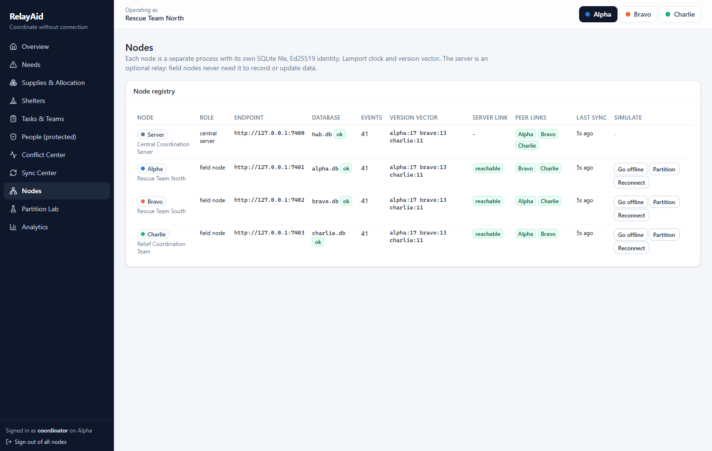

- **Nodes**: Alpha (Rescue Team North, :7401), Bravo (Rescue Team South, :7402), Charlie (Relief Coordination, :7403), and the central server (:7400). Each is an OS process running the same FastAPI service with its own SQLite file and Ed25519 key.
- **Write path**: authenticate operator → validate → build and sign event → append to local log → rebuild local state. No network involved.
- **Sync path**: handshake (version vectors) → pull missing events in causal order and bounded batches → push what the peer lacks → acknowledgement with the peer's new vector. Signed, gzip-compressed, retried with backoff, resumable.
- **Projection**: sorts the event set by (Lamport, origin, sequence) and applies per-field rules: LWW registers, max-lattices, multi-value registers for critical fields, PN-counter for occupancy, grow-only sets for notes and evidence, escrow/token validation for supplies. Conflicts are derived records, identical on every replica.
- **Server**: a well-connected replica without operator accounts or the data key; useful, never required.

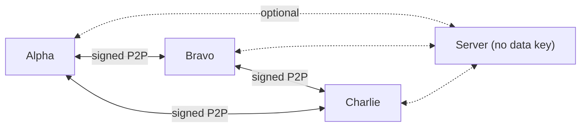

# Implementation

| Component | Technology | Highlights |
|---|---|---|
| Node service | Python, FastAPI, Pydantic | Operator API with roles; signed peer endpoints; OpenAPI docs |
| Storage | SQLite (one file per node) | Append-only `events`; local sync/sim/audit tables; rebuilt materialized tables |
| Event model | 32 event types with strict schemas | Ed25519 signatures; plaintext refused in sensitive fields |
| Merge and safety | Deterministic projection | Frontier-based registers; stable conflict ids; causal rights accounting; token epochs |
| Synchronization | httpx, gzip | Version-vector diffing; causal pagination; ACKs; retries; backoff; metrics; gossip thread |
| Security | `cryptography` | AES-256-GCM with record-bound AAD; scrypt key wrapping; sessions; nonce cache |
| Network lab | Per-node simulator | Offline, cut links, latency, loss, windows, duplicates, shuffling |
| Dashboard | React, TypeScript, Vite, Tailwind | 11 pages incl. Partition Lab with guided scenarios and a measured convergence runner |
| Tooling | Python scripts, Playwright | Cluster launcher, seeding, benchmarks, screenshots, PDF build; Docker Compose files |

Safety-critical rule implemented twice: the local API refuses an allocation the node holds no rights for (HTTP 409 with an explanation), and every replica re-checks every rights-spending event against the spender's causal past, rejecting any that fail.

# Testing

65 automated tests, all passing:

| Area | Tests | Examples |
|---|---|---|
| Offline & synchronization | 12 | Fully offline node; P2P without server; relay via server; incremental, batched, duplicate, lossy, partial-window sync |
| Conflict resolution | 13 | Found vs missing preserved and disputed; open conflicts survive repeated sync; explicit resolution; resolution races; occupancy overflow |
| Convergence | 11 | Brief scenarios 1 and 4; 6 randomized partition runs; replay in random orders into a fresh node |
| Allocation safety | 12 | Brief scenario 3; token transfer semantics; forged allocations and overspends rejected everywhere; causal rights |
| Security | 17 | Unauthorized/replayed/tampered requests and events; RBAC; encryption at rest; server opacity; log hygiene; session expiry |

Tests assert converged state with SHA-256 digests of all tables and compare event-id sets to detect lost updates.

# Experimental Results

All measured on the reference laptop (details in `TESTING_AND_EVALUATION.md`).

| Experiment | Result |
|---|---|
| E1 Payload | ~129 wire bytes per event in bulk (3.9× compression); one-event sync ~660 B; no-op sync ~320 B regardless of history size |
| E2 Convergence | 40/40 partitioned trials converged, no lost updates; mean 317-789 ms over peer orders, up to 1,209 ms via the server (100 updates per node) |
| E3 Chaos | 25/25 randomized runs converged with identical event and conflict sets; 1,021 duplicates ignored |
| E4 Allocation safety | 267 attempts, 216 refused, 0 double allocations, stock never exceeded, 10/10 forged events rejected |
| E5 Duplicates | 400 duplicates ignored; state identical |
| E6 Loss 10/30/50 % | 15/15 converged; session success 100/95/80 % |
| E7 Rebuild | 9.6 / 110 / 312 ms for 100 / 1,000 / 3,000 events |
| E8 Real processes | Converged 394 ms after healing; 40.6 KB on the wire |

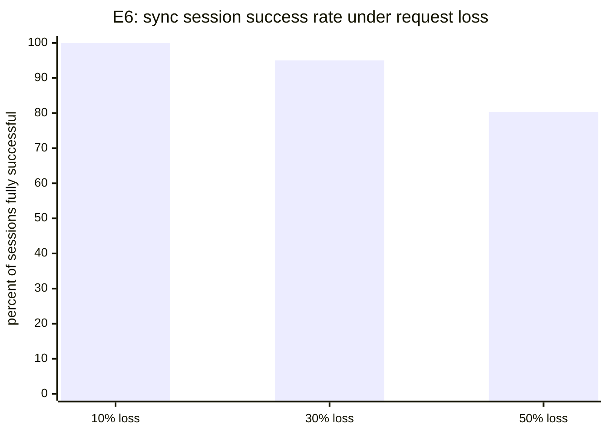

Interpretation: synchronization cost follows the amount of new information, not the size of the database; any connected sync order converges in two rounds; safety held in every run including forged input; and the main scalability limit is the full projection rebuild, which grows linearly.

# Screenshots

**Overview** - per-node status and a convergence check computed from state digests.

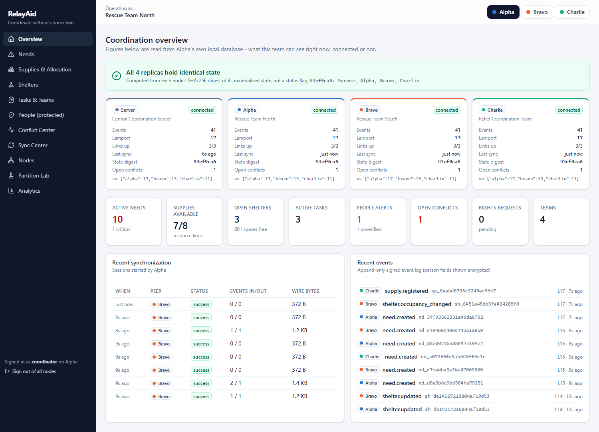

**Partition Lab** - Charlie isolated; scenario log; network conditions per node.

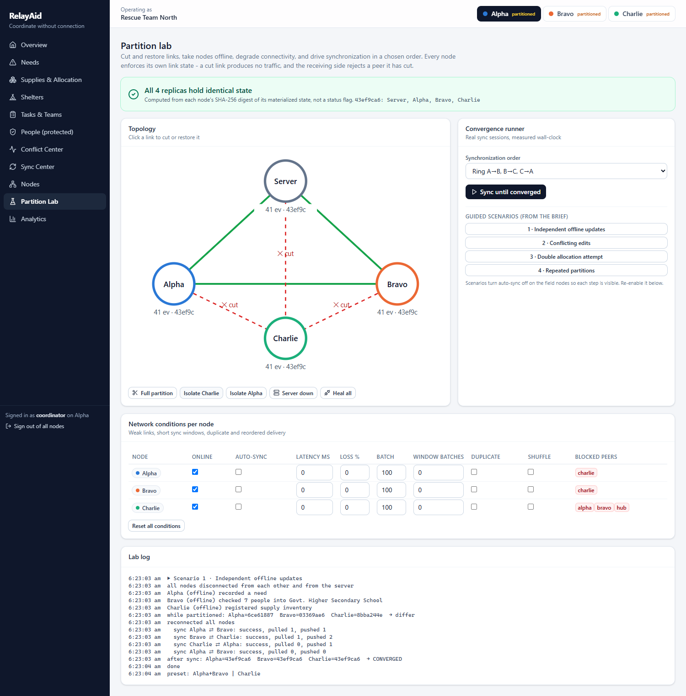

**Scenario 3** - Bravo's allocation of Alpha's boat refused while partitioned; exactly one allocation after sync.

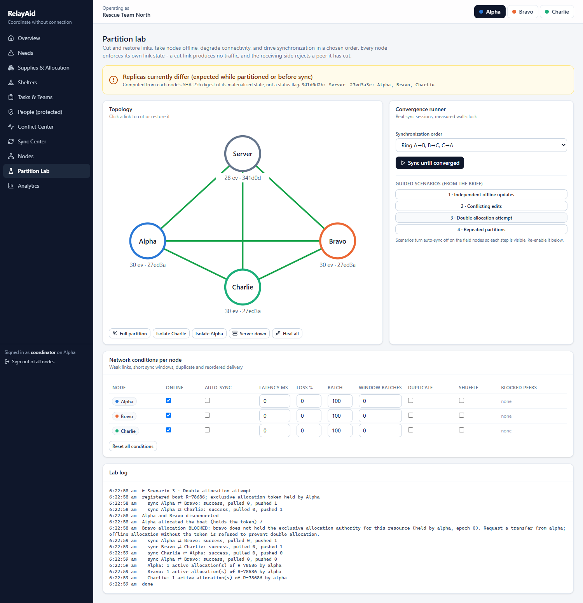

**Allocation refused** - the explanation shown to the operator.

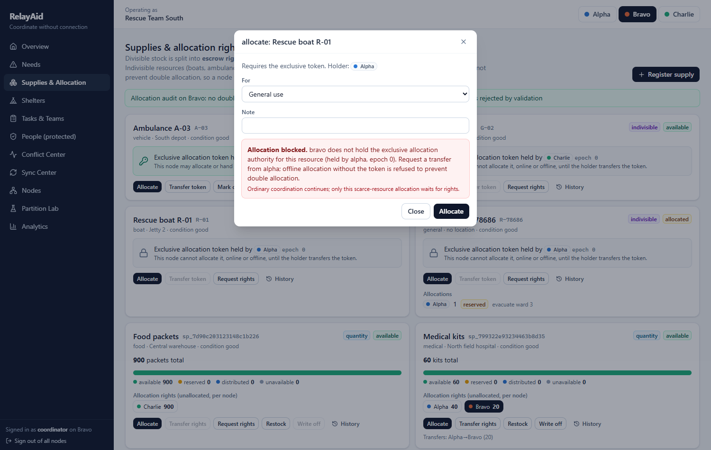

**Supplies** - escrow rights per node and exclusive tokens.

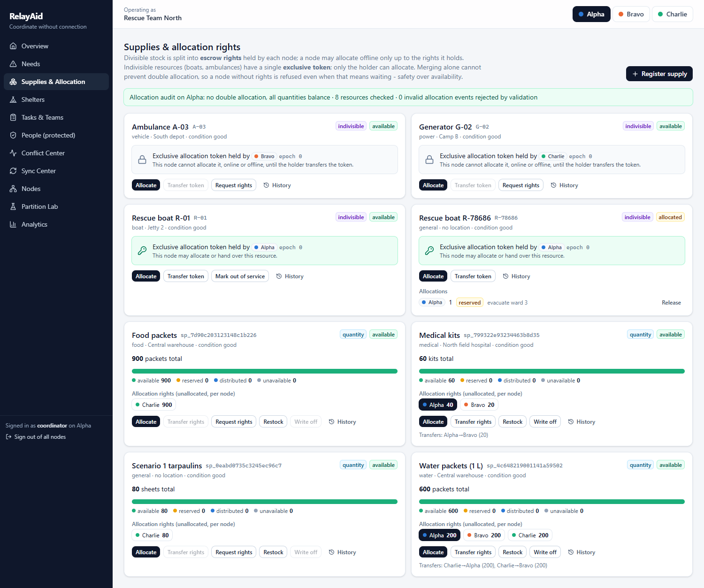

**Conflict Center** - a critical capacity conflict with both candidates and the resolution form.

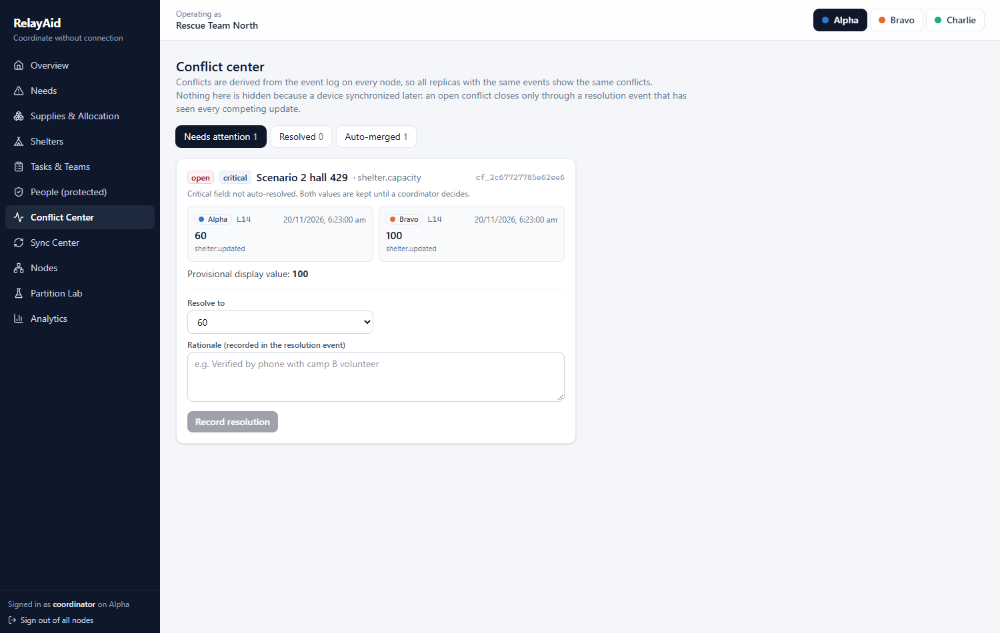

**People (responder view)** - status visible, details redacted.

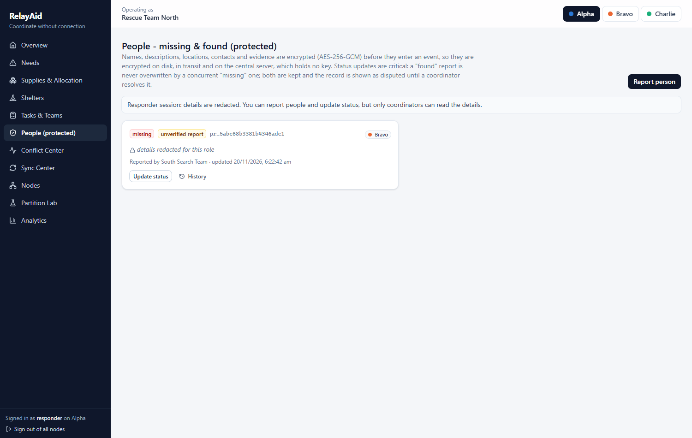

**Analytics** - measured session data only.

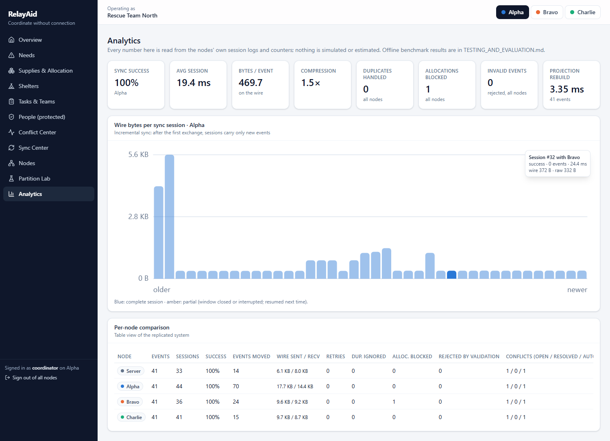

# Conclusion

RelayAid demonstrates that relief coordination can continue through network failure without giving up integrity. Independent replicas with signed event logs and deterministic projections converge after arbitrary partitions, as measured across 80+ runs with no lost updates. Field-specific merge semantics keep dangerous disagreements visible instead of resolving them silently. Escrow rights and exclusive tokens provide what merging cannot - a guarantee against double allocation - at an explicit, limited cost in availability for scarce resources only. Field-level encryption and a key-less server keep the most sensitive data protected. The project also documents its limits honestly: loopback HTTP transport, linear rebuild cost, no log compaction, and device keys without hardware protection.

# Future Scope

- Mobile clients using Bluetooth, Wi-Fi Direct or LoRa mesh transports; QR-code pairing.
- TLS / mutual TLS pinned to roster keys; SQLCipher; hardware-backed key storage; online key revocation.
- Snapshots, incremental projection and log compaction for large deployments.
- Rights leases, automatic rebalancing, and coordinator-signed recovery of lost tokens.
- Map-based views, SMS/USSD bridges where partial connectivity exists, schema upcasting for upgrades.
